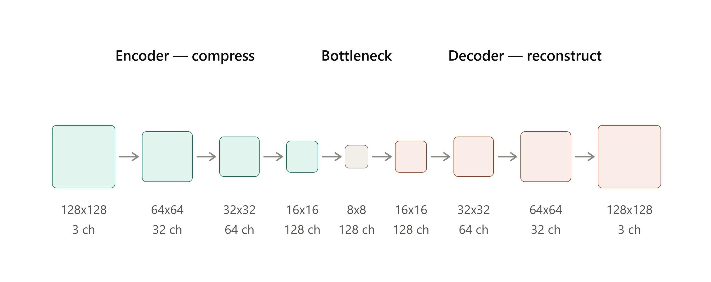

# Exit-8: Anomaly-detection-101

A learning project to understand, from scratch and fully local, how
**unsupervised anomaly detection** models work for industrial visual
inspection (metal parts, surfaces, etc.), before jumping into a production
stack like **AzureML + Triton Inference Server**.

## Motivation

Automotive parts inspection actually covers at least four different problem
types (surface defects, topographic defects, deterministic verification,
defect-type classification). This repo focuses **only on the first one**:
learning to tell "good part" from "anomalous part" **without using defect
labels during training** — the model only ever sees good parts, and learns
to recognize when something deviates from normal.

That mindset shift (from "classify" to "model what's normal and measure the
deviation") is the core pedagogical goal of this repo.

## Approach

- **Model**: simple convolutional autoencoder (PyTorch).
- **Training**: only on "good" (defect-free) images.
- **Inference**: reconstruction error (MSE) per image → *anomaly score*.
- **Threshold**: calibrated using the reconstruction error distribution on a
  held-out set of good parts (e.g. the 95th-99th percentile).
- **Dataset**: [MVTec AD](https://www.mvtec.com/research-teaching/datasets/mvtec-ad)
  (CC BY-NC-SA 4.0, non-commercial use). Recommended to start with a single
  category (`bottle`, `metal_nut`, or `screw`) before scaling up.

This is an intentionally simple starting point. It is **not** yet
PatchCore/PaDiM/EfficientAD or anything close to a production-grade method —
it's the "reality check" version meant to build intuition for the problem.



## Project structure

```
anomaly-detection-101/
├── README.md
├── LICENSE
├── requirements.txt
├── .gitignore
├── data/
│   ├── raw/                  # MVTec AD, untouched (not committed to git)
│   └── processed/            # cached splits/transforms, if any
├── src/
│   ├── __init__.py
│   ├── dataset.py            # PyTorch Dataset/DataLoader for MVTec AD
│   ├── model.py               # autoencoder architecture
│   ├── train.py               # training loop (good images only)
│   ├── evaluate.py            # anomaly score + metrics (ROC-AUC, etc.)
│   └── infer.py                # inference on a single image
├── notebooks/
│   └── 01_exploration.ipynb   # dataset EDA, reconstruction visualization
├── configs/
│   └── default.yaml           # hyperparameters, paths, category to use
├── models/                    # trained checkpoints (not committed to git)
├── outputs/                   # reconstruction images, curves, reports
├── tests/
│   └── test_dataset.py        # minimal data loading tests
└── .github/
    └── workflows/              # (future phase) CI/CD to AzureML/Triton
```

## Quickstart (local)

```bash
# 1. Clone and create the environment
git clone <repo-url>
cd anomaly-detection-101
python -m venv .venv
source .venv/bin/activate  # Windows: .venv\Scripts\activate
pip install -r requirements.txt

# 2. Download MVTec AD and unzip it into data/raw/
#    Expected structure per category, e.g. data/raw/bottle/{train,test,ground_truth}
#    Our case (for the moment) is bottle and metal_nut, so we have to perform a sanity check like
python -m src.dataset --category <category-name>
#    Now a quick sanity check of the autoencoder
python -m src.model

# 3. Train (good images only)
python -m src.train --category <category-name>

# 4. Evaluate on the test set (good + anomalous images)
python -m src.evaluate --category <category-name>

# 5. Run inference on a single image
## Recalibrates threshold eon each run (slower, but autocontained)
python -m src.infer --image path/a/imagen.png --category <category-name>

# Or if you already know the numerical value of the threshold you already like
python -m src.infer --image path/a/imagen.png --category <category-name> --threshold 0.0015

# 6. Once the model is validated, we must export it to an inference-ready format for Triton
## Triton does not run raw PyTorch checkpoints, it needs either ONNX or a TorchScript instead
## ONNX is a framework-agnostic graph format and TorchScript is a serialized traced version of Torch itself

### Cases of use 
python -m src.export_model --category <category-name> --version <n> # default --format onnx
python -m src.export_model --category <category-name> --version <n> --format torchscript
python -m src.export_model --category <category-name> --version <n> --format both # it will store both data outputs
```

## Considerations

So far `bottle` and `metal_nut` datasets were used to train and evaluate, all scripts were updated and now model is a scalable approach. However results were very different because of datasets definitions, in the case of `bottle` dataset we reached an optimal AUC ROC making it able to infer over new images, but for `metal_nut` the results were very poor reaching an AUC ROC of 55% which means this model cannot be used to infer.

Because of this we will use `bottle` as main model until we explore more advance models such as PatchCore.

## Roadmap

- [x] Simple autoencoder, single category, fully local.
- [x] Extend to multiple dataset categories.
- [x] Add standard benchmark metrics (image-level ROC-AUC).
- [ ] Explore a stronger method (PaDiM / PatchCore) for comparison.
- [ ] Package the model to be served with Triton Inference Server.
- [ ] Migrate training/deployment to AzureML.
- [ ] Automate the pipeline with GitHub Actions (training job + deployment).

## Appendix

### Rules to configure config.pbtxt

|.pbtxt field |	where does it come from|
|-------------|------------------------|
|name |	Name of the model folder |
|input[].name / output[].name |	Identical to input_names/output_names from torch.onnx.export |
|input[].dims / output[].dims |	Tensor shape without the batch dimension |
|max_batch_size |	Must be $> 0$ only if model was exported with dynamic_axes in dim 0 |

## Dataset and license

This project uses [MVTec AD](https://www.mvtec.com/research-teaching/datasets/mvtec-ad),
released under **CC BY-NC-SA 4.0** (non-commercial). The dataset is **not**
included in this repository — you need to download it directly from the
official source and place it under `data/raw/`.

This repository's own code is released under the same license,
**CC BY-NC-SA 4.0**, to stay consistent with the dataset's terms and to make
the non-commercial, academic intent explicit. See [`LICENSE`](./LICENSE) for
details.

## References

- Bergmann, P. et al. *"MVTec AD — A Comprehensive Real-World Dataset for
  Unsupervised Anomaly Detection"*, CVPR 2019.
- Bergmann, P. et al. *"The MVTec Anomaly Detection Dataset: A Comprehensive
  Real-World Dataset for Unsupervised Anomaly Detection"*, IJCV 2021.